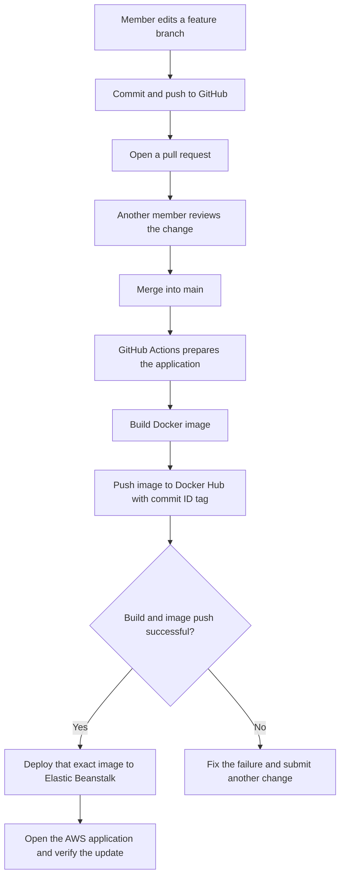
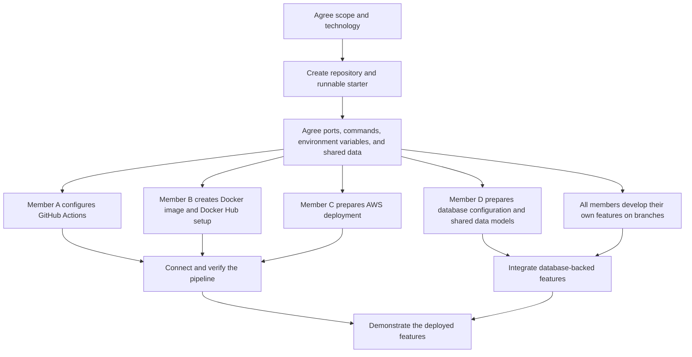

# Student Management System DevOps Assignment

We are building a simplified Student Management System for ABC University. Each of our four members owns one functional requirement. We share one application, one GitHub repository, and one CI/CD pipeline that delivers the application to AWS Elastic Beanstalk.

**Current status:** This README describes the proposed project and working process. The application, configuration files, and pipeline must still be implemented. The feature choices and technology stack below are recommendations for the group to confirm.

## Technology choices

| Area | Proposed choice | Reason |
| --- | --- | --- |
| Application language | Python | Use one language for application logic and supporting scripts. |
| Web framework | Django | Built-in forms, authentication, database models, and migrations suit a system that manages student records. |
| User interface | Django templates with HTML and CSS | Keep the pages and backend in one application to simplify development and deployment. |
| Database | PostgreSQL | Store related student, course, attendance, and result records in a relational database. |
| Source control and automation | GitHub and GitHub Actions | Review changes through pull requests and automate building and deployment. |
| Packaging and image storage | Docker and Docker Hub | Package the application and store a versioned image for deployment. |
| Application hosting | AWS Elastic Beanstalk Docker environment | Run the image published by our pipeline. |

Before creating the starter application, record compatible Python, Django, and PostgreSQL versions here. Use the same Python version locally, in GitHub Actions, and in the Docker image. Record the agreed Python dependencies in `requirements.txt`.

For the first pipeline demonstration, a working home page is sufficient. A cloud database can be connected when the features need it. Confirm the teaching account's permissions before choosing or provisioning its database service.

## Features and responsibilities

Replace Member A to Member D with our names after confirming the assignments. These four features are suggested selections from the assignment brief.

| Member | Individual functional requirement | Additional shared responsibility | Deliverables for the shared responsibility |
| --- | --- | --- | --- |
| Member A | Student registration and profile management | GitHub repository and GitHub Actions | Repository access, branch conventions, `build-push.yml`, build logs, and publishing integration with Member B. |
| Member B | Course and subject registration | Docker and Docker Hub | `Dockerfile`, `.dockerignore`, local container instructions, image repository, and image tagging agreement. |
| Member C | Attendance records | AWS deployment | Elastic Beanstalk environment, deployment configuration, `deploy.yml`, and verification of the running application. |
| Member D | Examination and assessment results | Database coordination | Shared data model agreement, local PostgreSQL setup, connection settings, migration coordination, and sample records. |

Everyone develops and manually checks their own feature, reviews another member's changes, records their contribution, and learns how the complete pipeline works. The database lead coordinates shared changes; feature owners still write the models and migrations needed by their own features.

## How a change reaches AWS



The application preparation stage installs dependencies and checks application configuration. Python applications do not need to produce a compiled executable to demonstrate an automated build. The Docker build creates our deployable application package.

If CI and CD use separate workflow files, `deploy.yml` must check the upstream run's success and deploy the image tag from that run. Completion alone does not mean success. Updating Docker Hub alone does not trigger an Elastic Beanstalk deployment; our deployment workflow performs that update.

## Prepare together before working in parallel

| Preparation | What we must agree or create | Ready when |
| --- | --- | --- |
| Feature scope | Four selected requirements, each feature's main actions, and its owner. | Each owner can describe a short demonstration of their feature. |
| Technology and structure | Runtime versions, Django project name, feature folders, and a shared page layout. | Everyone uses the same application structure and dependency list. |
| Runnable starter | A minimal Django application with a home page and a simple `/health/` route. Create these on a setup branch and merge them after review. | Everyone can run the starter locally. The health route returns HTTP 200 without requiring the database. |
| Application contract | Agree the startup command, container port `8000`, dependency installation, and environment variable names. | Docker, Actions, and deployment owners can configure the same application consistently. |
| Accounts and access | GitHub access, Docker Hub repository and visibility, AWS region, and Elastic Beanstalk permissions. | Each lead can access the service needed for their work. |
| Shared data | Agree identifiers, relationships, shared model ownership, and sample data. | Features can refer to the same students and courses without creating duplicate definitions. |

The project scope alone is not sufficient for implementation. We need a runnable starter and these shared agreements. We do not need all four features to be completed first.

## Work in parallel after the starter runs



Parallel work still has dependencies: Actions needs a working Dockerfile before it can build an image; deployment needs a published image; database-backed features need agreed models and connection settings. The leads can prepare their files and accounts while these dependencies are being completed.

| Milestone | Completion condition |
| --- | --- |
| Starter ready | Every member can run the same basic application. |
| Container ready | The basic application opens successfully from a local Docker container. |
| Publishing ready | An update to `main` produces a successful Actions run and an image tagged with the commit ID. |
| Deployment ready | The published image runs on AWS. |
| Automatic delivery ready | A visible page change reaches AWS after a reviewed merge, without a manual rebuild or redeployment. |
| Features ready | All four features work together in the deployed application and each member has demonstration evidence. |

## Planned repository layout

This is the target structure to create, not a list of files already implemented.

```text
sms-devops/
|-- .github/
|   `-- workflows/
|       |-- build-push.yml
|       `-- deploy.yml
|-- config/                 Django project settings and application entry points
|-- students/               Student registration and profile feature
|-- courses/                Course registration feature
|-- attendance/             Attendance feature
|-- results/                Examination results feature
|-- templates/              Shared page templates
|-- static/                 Shared styles and assets
|-- docs/                   Diagrams and demonstration notes
|-- .env.example            Variable names and safe example values
|-- .gitignore
|-- .dockerignore
|-- compose.yaml            Local PostgreSQL service named db with a named data volume
|-- Dockerfile
|-- Dockerrun.aws.json       Generated deployment manifest for a specific image tag
|-- manage.py
|-- requirements.txt
`-- README.md
```

## Local development setup

**Use these instructions after the starter application, `requirements.txt`, `.env.example`, and `compose.yaml` have been created and checked. They are the target quickstart for the agreed structure.**

Prerequisites are Git, the agreed Python version, and Docker Desktop running Linux containers. Clone the shared GitHub repository and open PowerShell in its root folder.

1. Create a Python environment and install dependencies:

   ```powershell
   python -m venv .venv
   .\.venv\Scripts\python.exe -m pip install -r requirements.txt
   ```

2. Copy the example configuration and fill in the local values:

   ```powershell
   Copy-Item .env.example .env
   ```

   The starter application's settings must load `.env` locally and read environment variables on AWS. Copying the file alone does not configure Django.

3. Start the agreed local database service and wait until it is ready:

   ```powershell
   docker compose up -d db
   ```

4. Apply the committed migrations, check configuration, and run the application:

   ```powershell
   .\.venv\Scripts\python.exe manage.py migrate
   .\.venv\Scripts\python.exe manage.py check
   .\.venv\Scripts\python.exe manage.py runserver
   ```

5. Open `http://127.0.0.1:8000/`. Check the home page and the feature being developed.

`runserver` is for local development. The Docker image deployed to AWS should use a production server such as Gunicorn and the agreed port, for example `gunicorn config.wsgi:application --bind 0.0.0.0:8000`. The Docker owner must also configure static file collection and serving for the deployed application.

### Shared environment variable contract

These are proposed names for our settings and configuration files to implement consistently.

| Variable | Purpose |
| --- | --- |
| `DJANGO_SECRET_KEY` | Application secret, with separate local and deployed values. |
| `DJANGO_DEBUG` | Enable locally; disable for the deployed application. |
| `DJANGO_ALLOWED_HOSTS` | Allowed local or deployed hostnames; settings must parse the agreed format. |
| `DB_NAME` | PostgreSQL database name. |
| `DB_USER` | PostgreSQL user. |
| `DB_PASSWORD` | PostgreSQL password. |
| `DB_HOST` | Use `127.0.0.1` when Django runs on the host and PostgreSQL is published locally; use the actual database endpoint on AWS. |
| `DB_PORT` | PostgreSQL connection port; proposed default `5432`. |

If the application later runs in the same Compose network as the `db` service, its database hostname becomes `db`. Localhost inside an application container refers to that container itself.

Keep `.env`, `.venv`, local database files, and credentials out of Git and the application image. Commit `.env.example` with placeholders. Docker Hub publishing credentials belong in GitHub Actions secrets. Agree the supported AWS authentication method with the teaching account administrator; temporary AWS credentials also require their session token.

## Database responsibilities

- The database lead coordinates student and course identifiers, relationships, connection variables, and sample records.
- Each feature owner creates and commits migrations for their model changes. Review changes to shared models with the affected owners before merging.
- Do not connect to the deployed database or apply its migrations while building the Docker image. Agree a separate deployment step for applying migrations before releasing features that require them.
- Store deployed records in a database outside the application container so replacing the application does not discard them. If permitted by the teaching account, Amazon RDS for PostgreSQL is one option; final hosting remains to be confirmed.
- Keep the first pipeline proof independent of database availability by using the home page or health route.

## Development and review process

1. Update the local `main` branch before starting a feature branch.
2. Use clear branch names such as `feature/student-profile`, `feature/course-registration`, `setup/docker`, or `setup/github-actions`.
3. Make a small change and check it locally. For a feature, manually check normal use, invalid input, and relevant database behaviour.
4. Commit with a clear message and push the branch.
5. Open a pull request explaining the change, how it was checked, and any migration or configuration changes.
6. Ask another member to review it, resolve comments, and merge accepted changes into `main`.
7. Check the resulting pipeline and deployed application. Record the commit ID and useful evidence.

Only accepted changes on `main` should publish the shared deployment image and update AWS. If pull-request checks are added, keep them to checks/builds without publishing or deploying.

## Assignment evidence and next phase

For Part 1, each member prepares their own 8-10 minute video covering their selected functional requirement, implementation explanation, contribution evidence, and its journey through the shared pipeline. Collect commits, pull requests, Actions logs, Docker Hub image tags, AWS deployment status, and the running feature.

The lecturer clarification recorded in our workflow notes says automated testing in GitHub Actions is not required for Part 1. We still manually verify the application. Database deployment is supporting work when needed by the selected features.

Part 2 is design and documentation with no coding required. Propose and justify the revised pipeline, automated testing, quality and security checks, staging, controlled production deployment, infrastructure as code, monitoring, logging, and rollback. Produce the overall DevOps, CI/CD, Docker, cloud, and monitoring diagrams and evaluate benefits, challenges, cost, security, scalability, reliability, and maintainability. Include references and the required GenAI declaration.

## Reference material

- Course assignment brief: `CT142-3-3-DevOps-Assignment.docx`.
- Group workflow notes following lecturer discussion: `DevOps Workflow.md`.
- [Django getting started](https://www.djangoproject.com/start/).
- [Django deployment checklist](https://docs.djangoproject.com/en/5.2/howto/deployment/checklist/).
- [Dockerfile overview](https://docs.docker.com/build/concepts/dockerfile/).
- [GitHub Actions workflows](https://docs.github.com/en/actions/concepts/workflows-and-actions/workflows).
- [Triggering a workflow after another workflow](https://docs.github.com/en/actions/reference/workflows-and-actions/events-that-trigger-workflows#workflow_run).
- [Docker image deployment on Elastic Beanstalk](https://docs.aws.amazon.com/elasticbeanstalk/latest/dg/single-container-docker-configuration.html).
- [Using Elastic Beanstalk with Amazon RDS](https://docs.aws.amazon.com/elasticbeanstalk/latest/dg/AWSHowTo.RDS.html).
