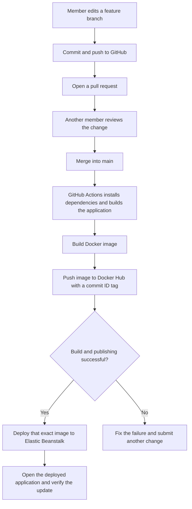
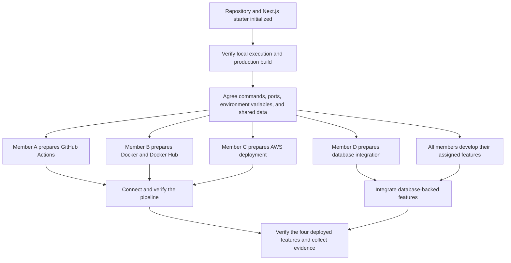

# Student Management System DevOps Assignment

We are building a simplified Student Management System for ABC University using Next.js and TypeScript. Each of our four members owns one functional requirement. We share one application, one GitHub repository, and one CI/CD pipeline that delivers a Docker image to AWS Elastic Beanstalk.

**Current stage:** The GitHub repository and Next.js starter have been initialized. This README records the proposed working process. Successful local execution, production building, database integration, and automated deployment must be verified as those steps are completed.

## Technology and scope

| Area | Selection or current decision |
| --- | --- |
| Application language | TypeScript, as indicated by the existing TypeScript configuration. |
| Framework and UI | Next.js with React and the App Router, using the existing `src/app` directory. |
| Server runtime | Node.js. Agree a version supported by the Next.js version in `package.json` and use it locally, in Actions, and in Docker. |
| Package manager | npm, matching the committed `package-lock.json`. |
| Database | PostgreSQL is the proposed choice; the group must confirm it and select the database library or ORM before integration. |
| Source control and automation | GitHub and GitHub Actions. |
| Application packaging and registry | Docker and Docker Hub. |
| Application hosting | AWS Elastic Beanstalk using its Docker platform. |

The proposed architecture keeps the pages and server-side feature operations in one Next.js application. Database queries and credentials belong in server-side code. The database approach is not established by the default starter README.

The Vercel section in the generated starter README is generic deployment guidance. Our assignment deployment target is AWS Elastic Beanstalk. Next.js supports deployment as a Docker container, so the agreed CI/CD direction remains suitable.

## Run the existing starter locally

Install Git and the agreed Node.js version, clone the shared repository, and open a terminal in the repository root. Review `package.json` for the actual scripts and framework version.

1. Install the dependencies recorded in the lockfile:

   ```powershell
   npm ci
   ```

2. Start the development server:

   ```powershell
   npm run dev
   ```

3. Open `http://localhost:3000`.
4. With the current `src` layout, edit `src/app/page.tsx` and confirm that the page updates.
5. Stop the development server with Ctrl+C before checking the production application on the same port.

For the standard Next.js starter scripts, check the production build and server with:

```powershell
npm run build
npm run start
```

These instructions assume the conventional `dev`, `build`, and `start` scripts shown in the Next.js documentation. Confirm their definitions in this repository. Run the production start command only after the build succeeds. Production containers should use the agreed production startup command, rather than `npm run dev`.

For the first pipeline demonstration, the starter home page is enough. Do not wait for the four functional requirements or a deployed database before proving the pipeline.

## Features and group responsibilities

The four features below are suggested selections from the assignment. Replace Member A to Member D with our names and confirm the selections before feature implementation.

| Member | Individual functional requirement | Shared responsibility and deliverables | Main collaborators |
| --- | --- | --- | --- | --- |
| Member A | Student registration and profile management | GitHub and GitHub Actions: repository access, branch conventions, `build-push.yml`, build logs, and automated publishing. | B supplies the Dockerfile and registry settings; C consumes the successful build's image tag. |
| Member B | Course and subject registration | Docker and Docker Hub: `Dockerfile`, `.dockerignore`, local container instructions, registry setup, and image tag agreement. | A connects image building and publishing; C checks that the same container runs on AWS. |
| Member C | Attendance records | AWS deployment: Elastic Beanstalk environment, deployment manifest, `deploy.yml`, and verification of automatic updates. | A supplies the image tag; B helps with container startup and ports; D helps with database connectivity when needed. |
| Member D | Examination and assessment results | Database coordination: shared model agreement, connection setup, migration approach, and sample data. | All feature owners agree shared records and relationships; C coordinates the deployed database connection. |

Everyone implements and manually checks their own feature, reviews another member's changes, collects contribution evidence, and understands the complete pipeline. The database lead coordinates shared changes; each feature owner still implements the data access needed by their feature.

## CI/CD workflow



| Stage | What we configure | Completion condition |
| --- | --- | --- |
| Local application | npm dependencies, a working home page, and the existing Next.js scripts. | Each member can run the starter and produce a successful production build. |
| Docker packaging | A Node.js-based Dockerfile that builds the app and starts its production server; exclude local dependencies, build output, and secrets from the build context. | The application opens successfully from a local container. |
| Image publishing | GitHub Actions builds the application image and pushes it to Docker Hub after an accepted update to `main`. The build may run within the Dockerfile. | A successful workflow produces an image tagged with the commit ID. |
| AWS setup | A Docker environment and a single-container deployment manifest, `Dockerrun.aws.json` v1, referencing the published image and the agreed container port. | AWS can pull the image and run the application. |
| Automatic deployment | A deployment job or `deploy.yml` updates the AWS environment only after successful building and publishing. | A reviewed page change reaches AWS without a manual rebuild or redeployment. |

Use the agreed container port consistently; `3000` is a suitable starting choice for this project. Ensure the container server accepts connections on `0.0.0.0` and that the AWS manifest specifies the same port. The public AWS URL can use a different external port through the platform's proxy.

If separate CI and CD workflows are used, explicitly check the upstream run's success and deploy its exact image tag. Updating an image in Docker Hub alone does not update the AWS environment. For the remote-image approach, generate a deployment bundle containing the image manifest; the image is built in CI rather than rebuilt from source on Elastic Beanstalk.

## Prepare together before working in parallel

| Preparation | Agreement or result needed |
| --- | --- |
| Feature scope | Confirm four requirements, their owners, and the actions each member will demonstrate. |
| Runnable starter | Each member can run the same home page; confirm a production build succeeds. |
| Runtime and commands | Agree the Node.js version, npm usage, build command, production startup command, and container port. |
| Shared data | Agree student and course identifiers, relationships, shared model ownership, and the database library or ORM. |
| Environment settings | Agree server-side connection variable names and provide a safe `.env.example` when configuration is introduced. |
| Service access | Confirm GitHub access, Docker Hub repository visibility and credentials, AWS region, and permitted AWS services. |

Then proceed in parallel:



Actions needs the Dockerfile before image building can pass; deployment needs a published image; database-backed features need agreed data structures. Account setup, draft configuration, and feature development can proceed while these dependencies are completed.

## Repository structure

The initialized top-level structure shown by the team includes:

```text
repository/
|-- public/
|-- src/
|   `-- app/
|-- .gitignore
|-- AGENTS.md
|-- README.md
|-- eslint.config.mjs
|-- next.config.ts
|-- package-lock.json
|-- package.json
`-- tsconfig.json
```

Add the following as their owners implement the supporting work. These are planned additions, not files already verified in the repository:

| Planned item | Purpose |
| --- | --- |
| `.github/workflows/build-push.yml` | Build the image and publish it after an accepted update to `main`. |
| `.github/workflows/deploy.yml` | Deploy the successfully published image, if using a separate CD workflow. |
| `Dockerfile` and `.dockerignore` | Build and run the application container. |
| Deployment manifest template or generator | Produce `Dockerrun.aws.json` for the exact image tag being deployed. |
| `.env.example` | Document agreed variables using safe placeholders. |
| Server-only database code and migration files | Implement the agreed database approach after the group chooses its tooling. |
| `docs/` | Store architecture diagrams and demonstration notes. |

Keep feature pages under the existing `src/app` structure. Agree how shared components and server-side data access are organized before creating duplicate student or course definitions.

## Database and environment configuration

The database has not been selected by the starter template. Confirm PostgreSQL and the connection library or ORM with the group before writing its setup or migration commands.

When the database owner provides `.env.example`, create local settings in the repository root with:

```powershell
Copy-Item .env.example .env.local
```

Next.js loads its environment files from the repository root, including when source code is under `src`. A proposed connection variable is `DATABASE_URL`; the chosen database code must read it. Database credentials must remain server-only and must not use the browser-exposed `NEXT_PUBLIC_` prefix. Tools run outside Next.js, such as some migration tools, may need their own environment loading configuration.

Keep actual local environment files and credentials out of Git and the Docker image. Ensure `.env.example` is allowed by `.gitignore` so its safe placeholders can be committed. Configure cloud values through the deployment environment. Docker Hub publishing credentials belong in GitHub Actions secrets; use an AWS authentication method supported by the teaching account.

The database lead coordinates relationships, connection settings, and migrations. Feature owners implement their own data operations and review shared schema changes together. Agree a controlled deployment step for applying migrations; do not apply deployed database migrations during image building. Keep the initial home page and health route independent of database availability so the first pipeline proof stays simple.

If the deployed features need persistent records, use a database outside the application container. Confirm the teaching account's database permissions before provisioning a service; Amazon RDS for PostgreSQL is one possible option. Database hosting remains a group decision.

## Development and review process

1. Update the local `main` branch before starting a feature branch.
2. Use clear branches such as `feature/student-profile`, `feature/attendance`, `setup/docker`, or `setup/github-actions`.
3. Make a small change and check it locally. For a feature, manually check normal use, invalid input, and relevant database behaviour.
4. Commit with a clear message and push the branch.
5. Open a pull request describing the change, how it was checked, and any new configuration or migrations.
6. Another member reviews the change; resolve comments before merging.
7. Check the workflow and the deployed application after the merge. Record the commit ID and useful evidence.

Publish the shared image and deploy only accepted updates to `main`. If pull-request checks are introduced, run checks or builds without publishing or deploying. Confirm the lint script in `package.json` before documenting or adding a lint command.

## Assignment evidence and later design work

For Part 1, each member prepares an individual 8-10 minute video demonstrating their functional requirement, explaining its implementation, and showing contribution evidence and the shared deployment process. Collect commits, pull requests, Actions logs, image tags, AWS deployment status, and the working feature.

The lecturer clarification recorded in our workflow notes says automated tests in GitHub Actions are not required for Part 1. We still manually verify the application. Keep database work proportionate to the selected features.

Part 2 is design and documentation with no coding required. Propose and justify automated testing, quality and security checks, staging, controlled production deployment, infrastructure as code, monitoring, logging, and rollback. Produce the required architecture diagrams and evaluate benefits, challenges, costs, security, scalability, reliability, and maintainability. Complete references and the required GenAI declaration.

## References

- Course assignment brief: `CT142-3-3-DevOps-Assignment.docx`.
- Group workflow notes following lecturer discussion: `DevOps Workflow.md`.
- [Next.js deployment options and production commands](https://nextjs.org/docs/app/getting-started/deploying).
- [Next.js environment variables](https://nextjs.org/docs/app/guides/environment-variables).
- [GitHub Actions workflows](https://docs.github.com/en/actions/concepts/workflows-and-actions/workflows).
- [Triggering a workflow after another workflow](https://docs.github.com/en/actions/reference/workflows-and-actions/events-that-trigger-workflows#workflow_run).
- [Preparing Docker images for Elastic Beanstalk](https://docs.aws.amazon.com/elasticbeanstalk/latest/dg/single-container-docker-configuration.html).
